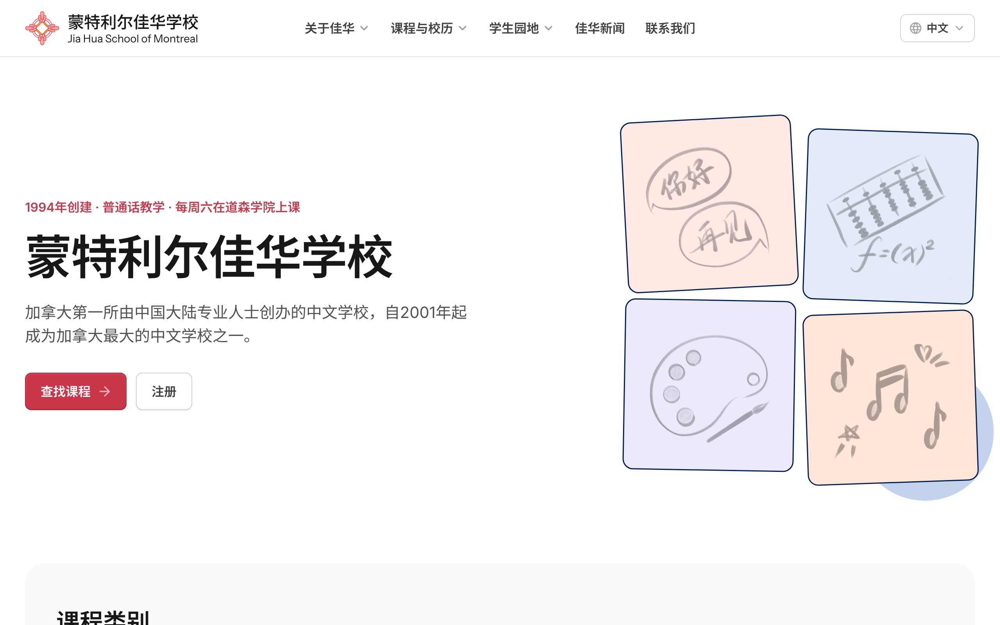
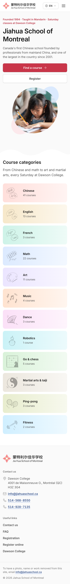
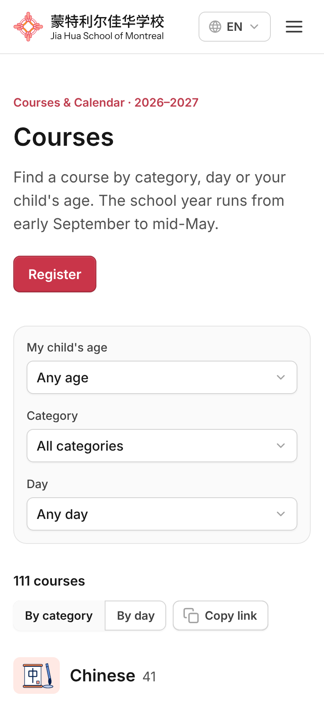

# 蒙特利尔佳华学校 · Jia Hua School of Montreal

The website of Jia Hua School of Montreal, a Chinese school founded in 1994. The site is in Chinese, French and English, and it is designed for parents on their phones first.

*Existing website: https://www.jiahuaschool.ca/*

*Preview project link: https://jiahua-school.vercel.app/en*



<p align="center">
  
  &nbsp;&nbsp;
  
</p>

## What's on the site

| Page | What parents find there |
| --- | --- |
| Home | An introduction to the school and the course categories |
| About | The school's history, the committee, teachers by subject, and teachers' insights |
| Courses | All 111 courses, filtered by the child's age, category or day, with a by-day timetable |
| Calendar | Class days, holidays and exams for the school year |
| Registration, FAQ, Contact | How to register, answers to common questions, the address and how to get there |
| Student Work | Essays, the art gallery and the school magazine |
| News | School announcements |

Every page exists in three languages at `/zh`, `/fr` and `/en`. Chinese is the default and the source language. When a French or English translation is missing, the Chinese text shows with a small "中文" tag, so nothing is ever blank.

## Built with

- [Next.js 16](https://nextjs.org) (App Router) and React 19
- [Tailwind CSS v4](https://tailwindcss.com)
- [Untitled UI React](https://www.untitledui.com/react) components on [React Aria](https://react-spectrum.adobe.com/react-aria/), with the Jia Hua red (#E84A5F) in place of the default purple
- Light and dark mode

## Run it on your computer

You need [Node.js](https://nodejs.org) 22 or newer.

```bash
git clone https://github.com/zhuzicui/jiahua-school.git
cd jiahua-school
npm install
npm run dev
```

Open http://localhost:3000. It goes to the Chinese site; switch languages from the header.

| Command | What it does |
| --- | --- |
| `npm run dev` | Starts the site locally and reloads on every change |
| `npm run build` | Builds the production site. GitHub runs this on every pull request. |
| `npm run start` | Serves the production build |

## Where things live

| Path | What it holds |
| --- | --- |
| `src/content/*.json` | All site content: courses, teachers, calendar, FAQ, news, essays and page text |
| `src/app/[locale]/` | One folder per page |
| `src/i18n/dictionary.ts` | Menu, button and label text in 中文, FR and EN |
| `src/components/site/` | Jia Hua components such as the header, footer, course finder and teacher directory |
| `src/components/base`, `application`, `foundations` | Untitled UI components. Use these before writing new ones. |
| `src/styles/theme.css` | Colours and fonts |
| `public/` | Logo, favicon and the hand-drawn course illustrations |

Pages read content only through `src/lib/content.ts`, so the content can later move to a database without changing the pages.

## Editing content

Each text field holds all three languages:

```json
{ "zh": "常见问题", "fr": "Questions fréquentes", "en": "FAQ" }
```

- Leave out `fr` or `en` when there is no translation yet. The Chinese text is shown instead.
- Students' names appear exactly as they are entered.
- To show a news post on the home page, set `"promote": true` and a `"promoteUntil"` date. It always stays in the News list.
- Course fees, teachers and rooms are blank for now and can be added to `src/content/courses.json` later.

## Making changes

1. Create a branch and edit the files.
2. Run `npm run build` and make sure it passes.
3. Open a pull request. GitHub checks the types and the build automatically.
4. Merge it into `main` once the checks pass.

The site is planned for [Vercel](https://vercel.com). Once the repository is connected there, every pull request gets a preview link and every merge to `main` goes live.

## Coming next

- Staff sign-in at `/admin`
- Editing page text and tables (courses, teachers, calendar) in the browser, with Excel import
- Bulk upload for art and essays
- A Translate button that drafts French and English for staff to review
- Content moved from JSON files into Supabase
